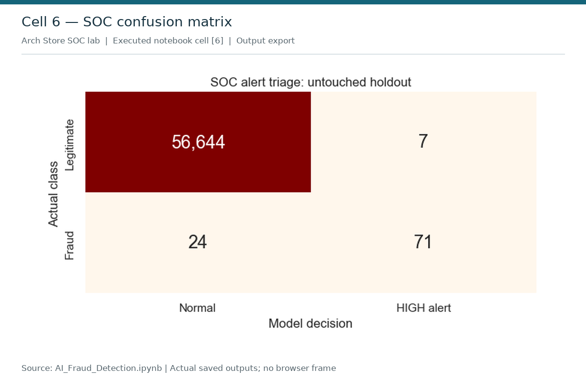
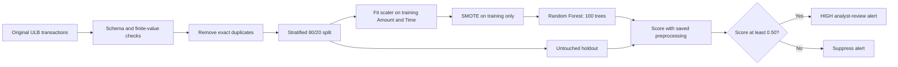

# AI-Driven Credit Card Fraud Detection (SOC Scenario)

Arch Store needs to flag suspected fraudulent transactions during an automated stolen-card attack while keeping legitimate customers out of the SOC queue. This offline lab builds a working Random Forest detection engine, executes a six-cell Jupyter notebook and records reviewable evidence.

At the fixed **0.50 fraud-score threshold**, the evaluated model suppresses **99.9876% of legitimate holdout transactions**, detects **71 of 95 labeled fraud cases**, and produces **7 false-positive review alerts**. The score is an uncalibrated model score. HIGH alerts request analyst review; the engine does not block payments.

## The scenario and scope

The bot attack and firewall failure are the scenario assumptions. The public ULB/Worldline benchmark provides historical transaction features and fraud labels; it contains no Arch Store production logs, card numbers, bot labels, IP addresses or account sessions. The implementation demonstrates supervised transaction-fraud classification and SOC triage. It does not establish that a particular transaction came from a bot.

The raw dataset is approximately 99.8% legitimate. That base rate is different from model performance. The operating target is **specificity >= 99.8%**, evaluated separately from fraud recall and precision.

## Measured results

| Metric | Untouched holdout result |
| --- | ---: |
| Test transactions | 56,746 |
| Fraud precision | 91.0256% |
| Fraud recall | 74.7368% |
| Fraud F1 | 0.8208 |
| Legitimate suppression / specificity | 99.9876% |
| False-positive rate | 0.0124% |
| HIGH alerts | 78 (0.1375% of holdout) |
| Average precision | 0.8072 |
| ROC AUC | 0.9608 |

| Actual class | Normal / suppressed | HIGH review alert |
| --- | ---: | ---: |
| Legitimate | 56,644 TN | 7 FP |
| Fraud | 24 FN | 71 TP |

**24 fraud cases were missed.** Fraud recall and customer friction must be considered together. An all-normal classifier would already achieve 99.8326% accuracy while detecting zero fraud, so accuracy alone is not the success criterion.



## Technical architecture



- **Algorithm:** `RandomForestClassifier(n_estimators=100, random_state=42, n_jobs=-1)`.
- **Preprocessing:** Pandas and training-only StandardScaler for Amount and Time; V1-V28 retain their supplied PCA values.
- **Imbalance:** SMOTE with `random_state=42`, applied only to training rows.
- **Evaluation:** Natural-prevalence holdout, confusion matrix, fraud precision/recall/F1, specificity, average precision and ROC AUC.
- **Alert contract:** `ARCH-ML-001`, severity `HIGH`, action `analyst_review`, score, threshold, model version and pseudonymous transaction ID.

Exact duplicate removal prevents the same feature row appearing in both train and test. This changes the modeling population from 284,807 raw rows to 283,726 unique rows (473 fraud), so the split counts differ from an uncorrected copy of the starter code.

## Run on Windows CMD

Python 3.13 was used for this run. In the repository folder:

```cmd
py -3.13 -m venv .venv
.venv\Scripts\activate.bat
python -m pip install -r requirements.txt
python scripts/download_data.py
python scripts/run_notebook.py
python scripts/export_evidence.py
python scripts/verify_project.py
python -m jupyterlab AI_Fraud_Detection.ipynb
```

The download script uses the public mirror documented in the [official TensorFlow tutorial](https://www.tensorflow.org/tutorials/structured_data/imbalanced_data). Alternatively, download the [original Kaggle dataset](https://www.kaggle.com/datasets/mlg-ulb/creditcardfraud), place `creditcard.csv` under `data/`, and run `python scripts/download_data.py --file data/creditcard.csv` to record its provenance. This project does not redistribute the raw dataset through GitHub or its release ZIP; consult the original dataset page for its terms.

`run_notebook.py` registers a kernel inside the active Python environment, executes all six cells, saves outputs after each cell, and exports a readable HTML notebook. `requirements.txt` pins the main packages; `requirements-lock.txt` records the complete environment used here. Training time varies by hardware; this run took 253.63 seconds.

To open the completed results without rerunning, view the notebook in GitHub or open `reports/AI_Fraud_Detection.html` in a browser. The evidence PNGs are labeled notebook-output exports, not live browser screenshots; the browser capture tool stopped at its URL-verification check. See docs/EVIDENCE.md for the remaining manual live-screenshot step if an assessor requires it. The local project folder also contains the downloaded CSV and trained model. The ZIP includes the trained model; GitHub excludes `data/` and `models/`.

## Use the detection engine

The notebook writes `models/fraud_engine.joblib`. Score a CSV containing exactly `Time`, `V1` through `V28`, and `Amount` (no `Class` label):

```cmd
python fraud_engine.py --input path\to\transactions.csv --output reports\new_high_alerts.jsonl
```

The CLI validates the feature schema, reuses the saved scaler, emits JSONL only for threshold crossings, and prints the suppressed/alert counts. Inputs must use the same anonymized feature definitions as the benchmark. Load only the trusted model artifact produced by this project.

## Evidence and project files

```text
ArchTech-AI-Fraud-Detection-SOC/
|-- .gitignore
|-- README.md
|-- requirements.txt
|-- requirements-lock.txt
|-- AI_Fraud_Detection.ipynb
|-- fraud_engine.py
|-- screenshots/                 # Actual executed-cell output exports
|   |-- 00-import-libraries.png
|   |-- 01-baseline-traffic.png
|   |-- 02-smote-balancing.png
|   |-- 03-confusion-matrix.png
|   |-- 04-detection-report.png
|   |-- 05-data-preprocessing.png
|   |-- 06-engine-trained.png
|   `-- 07-high-severity-alert.png
|-- docs/
|   |-- SOC_Detection_Report.md
|   `-- EVIDENCE.md
|-- scripts/
|   |-- download_data.py
|   |-- run_notebook.py
|   |-- export_evidence.py
|   `-- verify_project.py
|-- reports/                     # Metrics, predictions, alert replay, figures, HTML, manifests
|-- data/creditcard.csv          # Local only, ignored by Git, omitted from ZIP
`-- models/fraud_engine.joblib   # Local/ZIP artifact, ignored by Git
```

The [SOC report](docs/SOC_Detection_Report.md) explains the threat, triage, results and limits. The [evidence guide](docs/EVIDENCE.md) maps every screenshot to its cell. Machine-readable evidence lives in `reports/metrics.json`, `reports/test_predictions.csv`, `reports/high_severity_alerts.jsonl`, `reports/dataset_provenance.json`, `reports/execution_log.json`, `reports/verification.json` and `reports/evidence_manifest.json`.

Rerunning the notebook refreshes model outputs. Run scripts/export_evidence.py to recreate the evidence images and manifest for a new run. `verify_project.py` recomputes saved-model decisions and checks the current evidence hashes. Use `--skip-evidence` only while developing a new run before screenshots are captured.

## SOC metrics and skills demonstrated

- **False positives:** Legitimate transactions incorrectly sent to review; measure customer friction and analyst load.
- **False negatives:** Labeled fraud below the threshold; measure missed detection risk.
- **Skills:** ML for cybersecurity, detection engineering, class-imbalance handling, Python data analysis, reproducible evaluation, evidence capture and alert triage.

Before production use, validate on recent merchant data with a chronological split, calibrate on separate validation data, choose a threshold against review capacity and fraud loss, and monitor drift. The random holdout used here measures this benchmark split; it is not a future-traffic performance guarantee.

## Sources

- [ULB/Worldline dataset on Kaggle](https://www.kaggle.com/datasets/mlg-ulb/creditcardfraud).
- [TensorFlow: dataset mirror and training-only preprocessing](https://www.tensorflow.org/tutorials/structured_data/imbalanced_data).
- [imbalanced-learn: resampling leakage pitfalls](https://imbalanced-learn.org/stable/common_pitfalls.html).
- [OWASP OAT-001: Carding](https://owasp.org/www-project-automated-threats-to-web-applications/assets/oats/EN/OAT-001_Carding.html).
