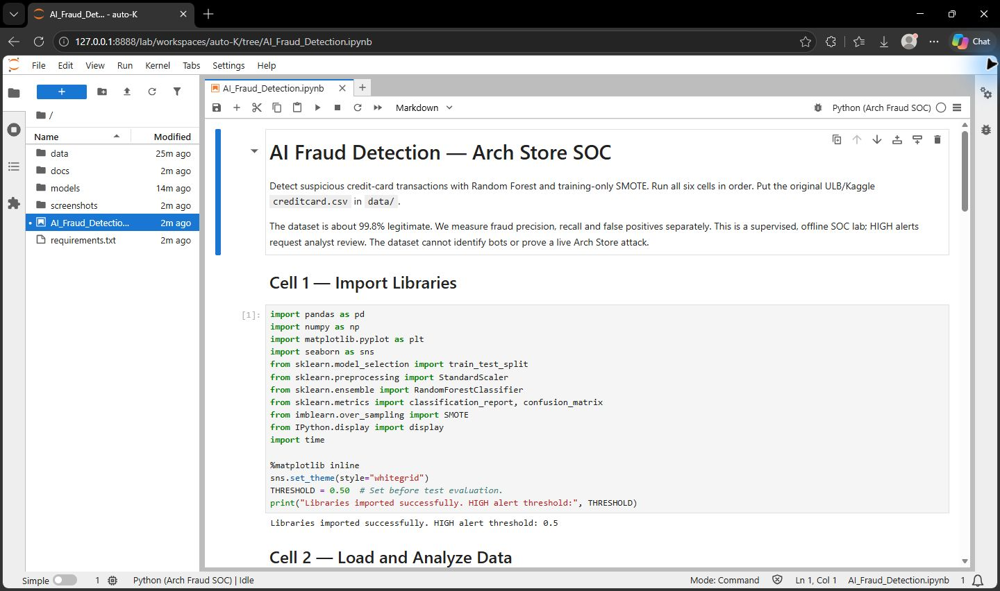

# AI Fraud Detection — Arch Store SOC

A small six-cell Jupyter project for the Arch Store stolen-card scenario. It uses Random Forest and SMOTE to flag suspicious transactions for HIGH-severity analyst review.

## Run

```cmd
py -3.13 -m venv .venv
.venv\Scripts\activate.bat
pip install -r requirements.txt
python -m ipykernel install --prefix .venv --name arch-fraud --display-name "Python (Arch Fraud SOC)"
python -m jupyterlab AI_Fraud_Detection.ipynb
```

Download the [ULB credit-card dataset](https://www.kaggle.com/datasets/mlg-ulb/creditcardfraud) and put `creditcard.csv` in `data/`. Use **Run > Run All Cells** in JupyterLab. The data folder is ignored by Git and omitted from the ZIP.

## Results

The original dataset has 284,807 transactions, including 492 fraud cases. Before splitting, 1,081 duplicates are removed. The scaler is fitted on training data only; SMOTE is applied only to training data.

| Test metric | Result |
| --- | ---: |
| Test transactions | 56,746 |
| Fraud detected / missed | 71 / 24 |
| False positives | 7 |
| Fraud precision | 91.03% |
| Fraud recall | 74.74% |
| Fraud F1 | 0.8208 |
| Legitimate suppression | 99.9876% |
| HIGH review alerts | 78 |

The threshold is fixed at 0.50 before evaluation. Alerts request review; this notebook does not block payments. The historical dataset does not identify bots or verify a live Arch Store incident.

## Files and evidence

- `AI_Fraud_Detection.ipynb`: all six cells with actual executed outputs.
- `requirements.txt`: the packages needed to run the notebook.
- [SOC report](docs/SOC_Detection_Report.md): scenario, method and measured results.
- `screenshots/`: genuine captures of JupyterLab on the PC.



**Evidence status:** The imports screenshot was captured directly from the Windows browser window. The remaining cell screenshots are pending because Computer Use stopped during refresh when browser-URL verification failed. The former generated output panels have been removed.
