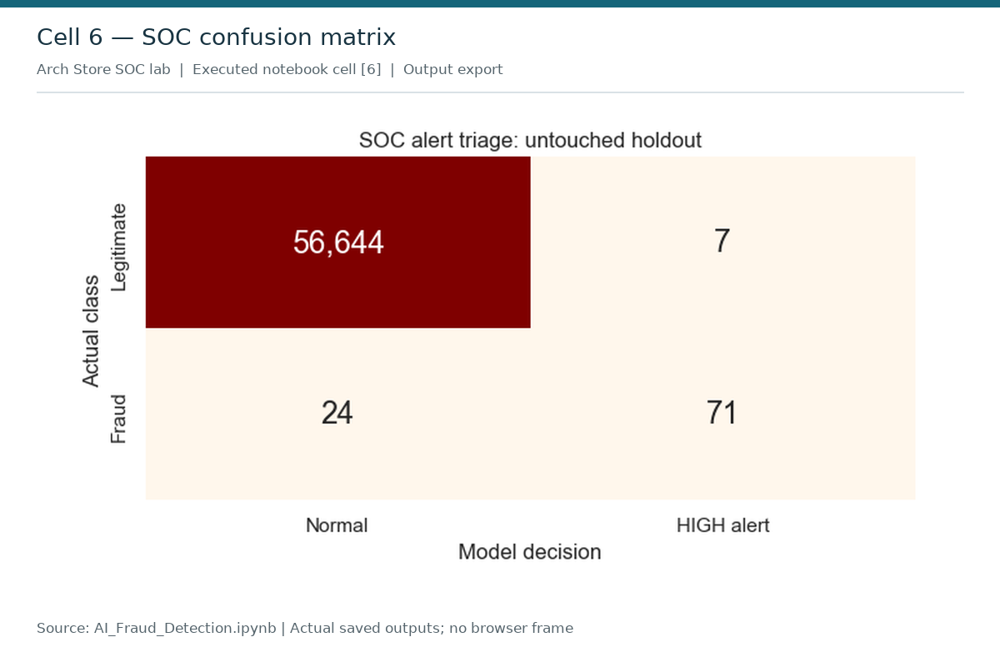
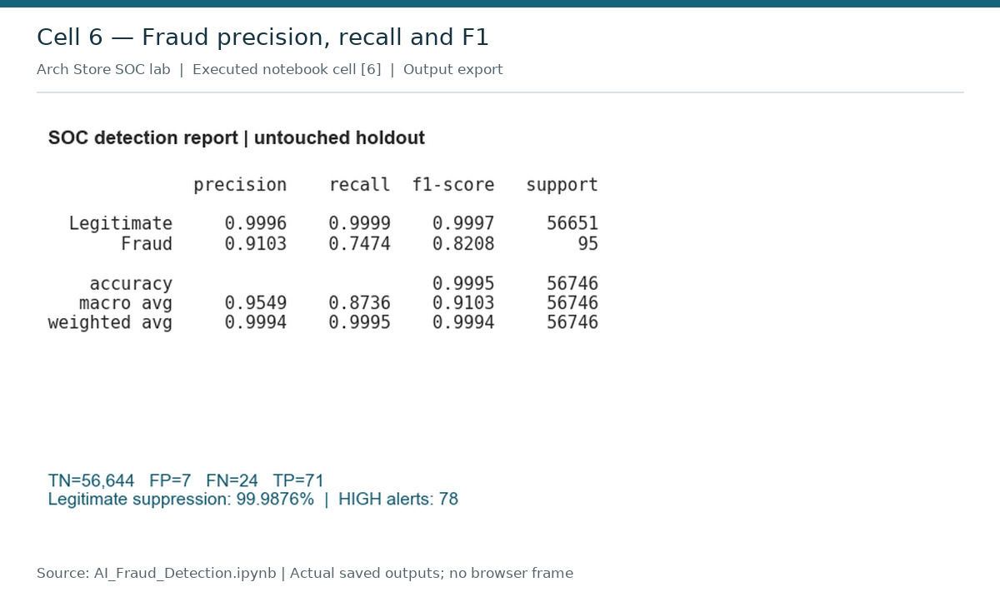

# SOC Detection Report: AI Fraud Engine

## 1. Threat overview

Arch Store is the scenario's e-commerce merchant. Attackers use stolen card data in automated payment attempts, creating a need to separate suspicious transactions from legitimate purchases.

Automated validation of stolen payment cards is mapped to [OWASP OAT-001 Carding](https://owasp.org/www-project-automated-threats-to-web-applications/assets/oats/EN/OAT-001_Carding.html). Using validated stolen cards to obtain goods is separately described by OWASP as OAT-012 Cashing Out. [MITRE ATT&CK T1110](https://attack.mitre.org/techniques/T1110/) addresses brute force against authentication credentials; T1110.004 applies to credential stuffing when stolen login credentials are replayed. This benchmark has no authentication evidence, so it does not support assigning T1110 to its fraud rows.

This is an offline benchmark experiment. The bot attack, failed firewall rules and Arch Store incident are scenario context, not observed production events.

## 2. Why a fixed SIEM amount rule can fail

A hypothetical `IF Amount > $5000 THEN ALERT` rule can miss low-value card-testing attempts and can flag valid large orders. It lacks the multivariate transaction context used by this classifier. No measured firewall or SIEM baseline is supplied, so this report makes no claim of an experimentally measured improvement over those systems. A firewall and a payment-fraud engine operate on different signals.

## 3. The ML solution and leakage controls

Random Forest learns labeled fraud patterns from the supplied 28 PCA components plus scaled Amount and Time. The PCA variables are anonymized; their original behavioral meanings cannot be recovered from this dataset.

The original [ULB/Worldline benchmark](https://www.kaggle.com/datasets/mlg-ulb/creditcardfraud) contains **284,807 transactions**, **284,315 legitimate** and **492 fraud**. Its legitimate fraction is 99.8273%. The CSV was downloaded from the mirror documented by [TensorFlow](https://www.tensorflow.org/tutorials/structured_data/imbalanced_data); its exact source, byte size and SHA-256 are recorded in `reports/dataset_provenance.json`.

Before the split, **1,081 identical rows** were removed. The resulting modeling population has **283,726 unique transactions** and **473 fraud labels**. A stratified 80/20 split uses `random_state=42`. The train/test feature overlap is zero. StandardScaler is fit on the training Amount and Time only, following the training-only transformation principle in the TensorFlow reference. The label is never passed to the engine as a feature.

This preserves the requested six-cell workflow while correcting whole-dataset scaling and repeated-row contamination. It is a supervised fraud classifier, rather than a label-free anomaly detector.

## 4. Imbalance resolution

The training split contains **226,980 records**: **226,602 legitimate** and **378 fraud**. Training-only SMOTE produces **453,204 training vectors**, with **226,602 per class**. It adds **226,224 synthetic fraud vectors**. These generated vectors are training samples, not additional real incidents.

The holdout contains **56,746 original unique transactions** with its natural class imbalance. It is never resampled. [imbalanced-learn's leakage guidance](https://imbalanced-learn.org/stable/common_pitfalls.html) explains why resampling before splitting gives misleading evaluation.

## 5. Triage and evaluation

The 100-tree forest was trained with seed 42 and `n_jobs=-1`. Training took 253.63 seconds on the execution machine. A **fixed threshold of 0.50** was declared before inspecting holdout performance. A HIGH review alert is emitted when the score meets or exceeds that threshold. The test set was not used for threshold tuning.

| Actual class | Normal / suppressed | HIGH review alert |
| --- | ---: | ---: |
| Legitimate | 56,644 TN | 7 FP |
| Fraud | 24 FN | 71 TP |

| Metric | Untouched holdout result |
| --- | ---: |
| Test transactions | 56,746 |
| Fraud precision | 91.0256% |
| Fraud recall | 74.7368% |
| Fraud F1 | 0.8208 |
| Legitimate suppression / specificity | 99.9876% |
| False-positive rate | 0.0124% |
| HIGH alerts | 78 (0.1375% of holdout) |
| Average precision | 0.8072 |
| ROC AUC | 0.9608 |

The model detects **71 of 95** labeled fraud cases and misses **24**. It creates **7** false-positive review alerts among **56,651** legitimate transactions. **78** transactions enter the HIGH queue; **56,668** produce no alert, including the missed fraud cases. The overall no-alert fraction is 99.8625%; legitimate suppression is the separate specificity metric.

The >=99.8% legitimate-suppression target is **met on this holdout**. This is not a guarantee about future traffic. The held-out fraud support is only 95 cases, so a single missed or detected case changes recall by 1.05 percentage points. An all-normal model would achieve 99.8326% accuracy and zero fraud recall.

True positives are correctly flagged for review, not proven to have been blocked. False positives measure review friction rather than actual customer blocks. False negatives are labeled fraud that would not enter this engine's alert queue at the selected threshold.

## 6. Alert handling

The engine produces `reports/high_severity_alerts.jsonl` from the untouched holdout as a benchmark replay. Each event contains `ARCH-ML-001`, a model version, pseudonymous source-row transaction ID, HIGH severity, score, fixed threshold and UTC generation time. It excludes raw card data and labels. Scores are uncalibrated because SMOTE changes training prevalence.

Analyst workflow:

1. Correlate the transaction with merchant payment, device, session and recent authorization history.
2. Review velocity, repeated declines, account history and available step-up signals.
3. Escalate confirmed clusters to fraud operations; apply merchant-approved review or step-up controls.
4. Record disposition labels and monitor precision, recall where labels mature, alert volume and drift.

No real payment action, customer block, SIEM transmission or live incident response was performed by this lab.

## 7. Evidence and reproducibility

All six notebook code cells retain executed outputs, and eight notebook-output evidence exports cover imports, baseline, preprocessing, SMOTE, completed training, confusion matrix, classification metrics and one HIGH alert. Live browser screenshots were not captured because Computer Use stopped at its browser-URL verification check. See [EVIDENCE.md](EVIDENCE.md) for capture details and the manual screenshot step if required by an assessor. Figures are also saved separately under `reports/figures/`; these standalone figure exports are distinguished from the labeled cell-output evidence panels.

`reports/metrics.json` contains the computed metrics and package versions. `reports/test_predictions.csv` preserves every holdout decision and source-row ID. `reports/execution_log.json` records stage timings. `scripts/verify_project.py` reloads the saved model, reproduces all holdout scores, checks preprocessing and alert behavior, validates notebook execution and verifies screenshot hashes. The dataset and model are excluded from Git by `.gitignore`.

## 8. Limits and production validation

The historical dataset does not contain merchant-specific labels for bot activity, card testing campaigns or account takeover. This experiment cannot verify attacker automation, identify stolen card numbers, quantify monetary loss prevented or establish performance on modern Arch Store customers. The PCA transform is supplied by the dataset; its original fitting population cannot be audited here.

A random split does not test chronological drift or separation by customer or card, because usable identifiers are unavailable. Before deployment, use recent merchant-owned data, time-based validation, delayed-label handling and validation-only threshold selection. Compare against existing fraud rules, calibrate scores on a separate validation population and budget for review volume. Validate latency and operational reliability under realistic load. Collect production outcomes before claiming reduced customer friction or prevented loss.
